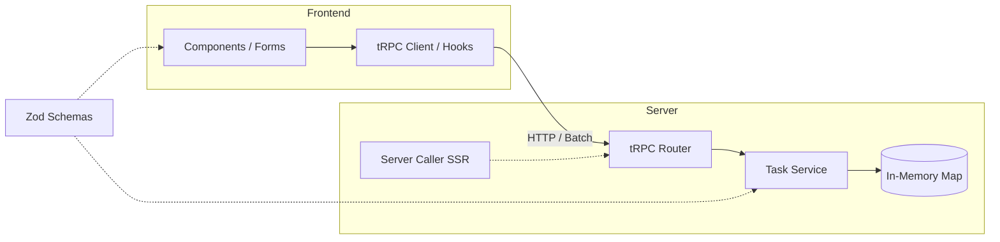

# Task Manager

A simple, fast, and type-safe task management web application built with **Next.js 15 (App Router)**, **React 19**, and **tRPC v11**.

The backend manages tasks in-memory without an external database, exposing a strongly-typed API through tRPC. The frontend leverages Server-Side Rendering (SSR) for instant first-page loads and dynamic infinite scrolling for subsequent pages.

---

## Features

- **Full CRUD Operations**: Create, read (list and single item), update, and delete tasks.
- **Server-Side Rendering (SSR)**: Initial tasks are preloaded directly on the server in-process without unnecessary network hops, hydrating seamlessly on the client.
- **Infinite Scrolling**: Automatically loads additional tasks via an `IntersectionObserver` as the user scrolls, paired with cursor-based pagination.
- **Business Rules Outside the Visual Layer**: UI components only manage presentation and user interaction. All domain logic, validation, and error handling reside in dedicated service and repository layers.
- **Shared Validation (Single Source of Truth)**: Zod schemas are shared between the tRPC backend and frontend forms, ensuring strict validation consistency with zero code duplication.
- **Rich Data Serialization**: SuperJSON preserves native `Date` objects (`dataCriacao`) across the wire without manual string conversions.
- **Visual Feedback & UX**: Immediate loading indicators on action buttons ("Deleting...", "Saving..."), inline field-level validation messages, and success/error alert banners.
- **Comprehensive Unit Tests**: Vitest suite with 100% test pass rate covering business rules, edge cases, and pagination behavior.

---

## Tech Stack

| Layer | Technology | Purpose |
|---|---|---|
| **Framework** | Next.js 15 (App Router) | Server components, file-based routing, and SSR |
| **UI Library** | React 19 | Modern functional components and hooks |
| **API & Client** | tRPC v11 + TanStack React Query v5 | End-to-end type safety between server and client |
| **Validation** | Zod 4 | Single source of truth for inputs and domain validation |
| **Serialization**| SuperJSON | Preserves `Date` objects and rich types over HTTP |
| **Styling** | Tailwind CSS v4 | Lightweight and responsive styling |
| **Testing** | Vitest | Fast unit testing for domain services |

---

## Architecture

The project strictly separates concerns into well-defined layers:

```
src/
├── app/                        # Next.js App Router (Pages & API route)
│   ├── api/trpc/[trpc]/        # tRPC HTTP Route Handler
│   ├── tasks/
│   │   ├── new/page.tsx        # Task creation page
│   │   └── [id]/edit/page.tsx  # Task edit page (SSR + 404 handling)
│   ├── layout.tsx              # Root layout with TRPCProvider
│   └── page.tsx                # Task listing (SSR preloading)
├── components/                 # Presentation layer (Pure UI)
│   ├── Feedback.tsx            # Alert banner for success & error messages
│   ├── TaskForm.tsx            # Reusable create/edit form with client validation
│   └── TaskList.tsx            # Infinite scroll list + inline deletion
├── server/                     # Backend domain & API
│   ├── routers/
│   │   ├── _app.ts             # App router definition & export type AppRouter
│   │   └── task.router.ts      # tRPC task procedures (transport only)
│   ├── tasks/
│   │   ├── task.repository.ts  # In-memory storage (Map + globalThis singleton)
│   │   ├── task.schema.ts      # Domain models and Zod validation schemas
│   │   ├── task.seed.ts        # 25 preloaded seed tasks for demoing infinite scroll
│   │   ├── task.service.ts     # Business rules & domain errors (TaskNotFoundError)
│   │   └── task.service.test.ts# Unit tests for the service layer
│   └── trpc.ts                 # tRPC initialization, SuperJSON, error formatting
└── trpc/                       # Client & server tRPC callers
    ├── client.tsx              # React client provider & React Query setup
    └── server.ts               # In-process server caller for Server Components (SSR)
```

### Data Flow



---

## Domain Model & API Endpoints

> **Note**: Field names (`id`, `titulo`, `descricao`, `dataCriacao`) intentionally follow the original specification, while UI labels, error messages, and documentation are in English.

```typescript
interface Task {
  id: string;          // UUID generated automatically
  titulo: string;      // Required, trimmed, max 120 chars
  descricao?: string;  // Optional, trimmed, max 1000 chars (empty strings normalize to undefined)
  dataCriacao: Date;   // Timestamp (preserved across updates)
}
```

### tRPC Procedures

| Procedure | Type | Input | Description | Error Handling |
|---|---|---|---|---|
| `task.list` | Query | `{ limit?: number, cursor?: string }` | Returns paginated tasks ordered newest first (`{ items, nextCursor }`) | `400 BAD_REQUEST` if limit > 50 |
| `task.getById` | Query | `{ id: string }` | Retrieves a single task by ID | `404 NOT_FOUND` if task does not exist |
| `task.create` | Mutation | `{ titulo: string, descricao?: string }` | Creates a new task with generated ID and timestamp | `400 BAD_REQUEST` if title is empty |
| `task.update` | Mutation | `{ id: string, titulo: string, descricao?: string }` | Updates editable fields, keeping original timestamp and ID | `404 NOT_FOUND` if unknown ID, `400` if invalid |
| `task.delete` | Mutation | `{ id: string }` | Removes the task | `404 NOT_FOUND` if unknown ID |

---

## Key Architectural Decisions

1. **In-Memory Store in `globalThis`**:
   In Next.js, modules can be re-evaluated during development (hot reloading) or split across server chunks. Storing the `Map` on `globalThis` guarantees that mutations from API handlers reflect immediately in Server Component SSR renders without state divergence.
2. **Deterministic Cursor-Based Pagination (`timestamp_id`)**:
   Instead of fragile offset-based pagination (which skips or duplicates items when a task is deleted while scrolling) or pure ID cursors (which fail if the cursor task itself is deleted), our cursor encodes `${dataCriacao.getTime()}_${id}`. This ensures stable pagination even when items are concurrently created or deleted.
3. **Decoupled Domain Errors**:
   The `taskService` throws a pure domain error `TaskNotFoundError` with no knowledge of tRPC or HTTP. A tRPC middleware intercepts and maps it to `NOT_FOUND` (404), keeping business logic fully portable and testable in isolation.
4. **Shared Schemas for Backend & Frontend**:
   The form reuses `createTaskInput` to validate inputs before submission, giving immediate feedback without duplicating validation logic between client and server.

---

## Getting Started

### Prerequisites

- **Node.js**: v20 or higher (developed and tested on Node v24)
- **npm**: v10 or higher

### Installation

Clone the repository and install dependencies:

```bash
git clone https://github.com/pedrodorini/task-manager.git
cd task-manager
npm install
```

### Running the Development Server

```bash
npm run dev
```

Open [http://localhost:3000](http://localhost:3000) with your browser to explore the app. 25 realistic sample tasks are loaded on startup to demonstrate the infinite scroll out-of-the-box.

### Running Unit Tests

```bash
# Run tests once
npm test

# Run tests in watch mode
npm run test:watch
```

### Building for Production

```bash
# Create optimized production build
npm run build

# Start the production server
npm run start
```

### Linting & Type Checking

```bash
# Run ESLint
npm run lint

# Run TypeScript compiler check
npx tsc --noEmit
```

---

## Limitations

- **In-Memory Storage**: Data persists in memory as long as the Node process is alive. Restarting the server resets state to the default seed tasks. In multi-instance serverless deployments (such as Vercel serverless functions), each instance maintains its own memory; for production scaling, swapping `TaskRepository` for PostgreSQL/Prisma or SQLite is straightforward thanks to the repository interface.
